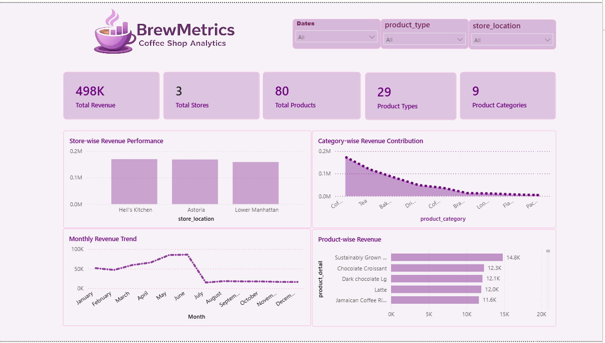

# Coffee Shop Sales Analysis

This project is based on coffee shop sales data. I created an interactive dashboard using Power BI to analyze sales performance.

## KPIs
- Total Revenue
- Total Transactions
- Total Quantity Sold
- Average Order Value
- Total Products
- Total Stores

## Analysis
- Monthly Sales
- Store-wise Sales
- Category-wise Sales
- Product-wise Sales
- Hourly Sales

## Tools
- Power BI
- DAX
- Excel

## Project Type
Practice Project

## Dashboard Preview

